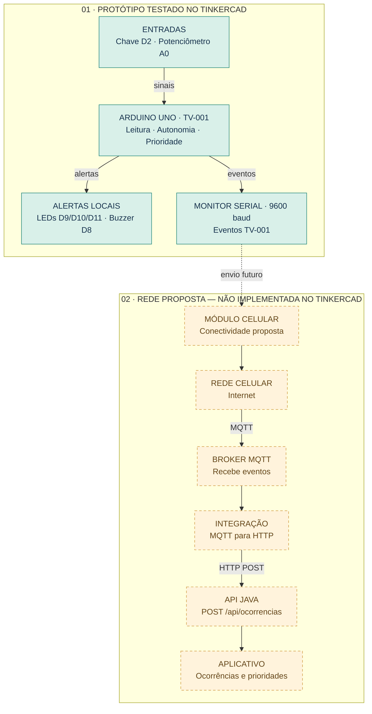

# Diagrama de arquitetura e comunicação — Tomada Vital

O diagrama distingue o **protótipo testado no Tinkercad** da **rede proposta pela equipe**, ainda não implementada no simulador.



## Identificação dos componentes

| Elemento | Implementado? | Papel |
|---|---|---|
| Chave deslizante D2 | Sim (simulado) | Presença/queda de energia |
| Potenciômetro A0 | Sim (simulado) | Percentual de bateria |
| Arduino UNO | Sim (simulado) | Leitura, cálculo e classificação |
| LEDs D9/D10/D11 e buzzer D8 | Sim (simulado) | Alertas locais |
| Monitor Serial (9600 baud) | Sim | Exibe eventos e resultados |
| Módulo celular | Não | Transporte de eventos na implantação proposta |
| Rede celular e Internet | Não | Conectividade externa proposta |
| Broker MQTT | Não | Recebe eventos no tópico previsto |
| Serviço integrador | Não | Converte evento MQTT em requisição HTTP |
| API Java e aplicativo | Não demonstrados nesta entrega IoT | Registro e visualização previstos pela equipe |

## Mensagens e integração previstas pela equipe

Tópico MQTT proposto: `tomadavital/TV-001/eventos`

Exemplo de evento do protótipo:

```text
TV-001;QUEDA;bateria=20;restante=96;prioridade=CRITICA
```

Exemplo do envio ao endpoint da API Java indicado no material da equipe:

```http
POST /api/ocorrencias
Content-Type: application/json

{"codigoDispositivo":"TV-001","bateriaPercentual":20}
```

**Limites e honestidade técnica:** o módulo celular e a comunicação MQTT são parte do desenho proposto, não do circuito executado no simulador; a API Java pertence ao projeto integrado da equipe. A bateria e o sensor de energia foram representados por componentes de simulação, e os limiares de autonomia são exemplos acadêmicos, não critérios médicos validados.
