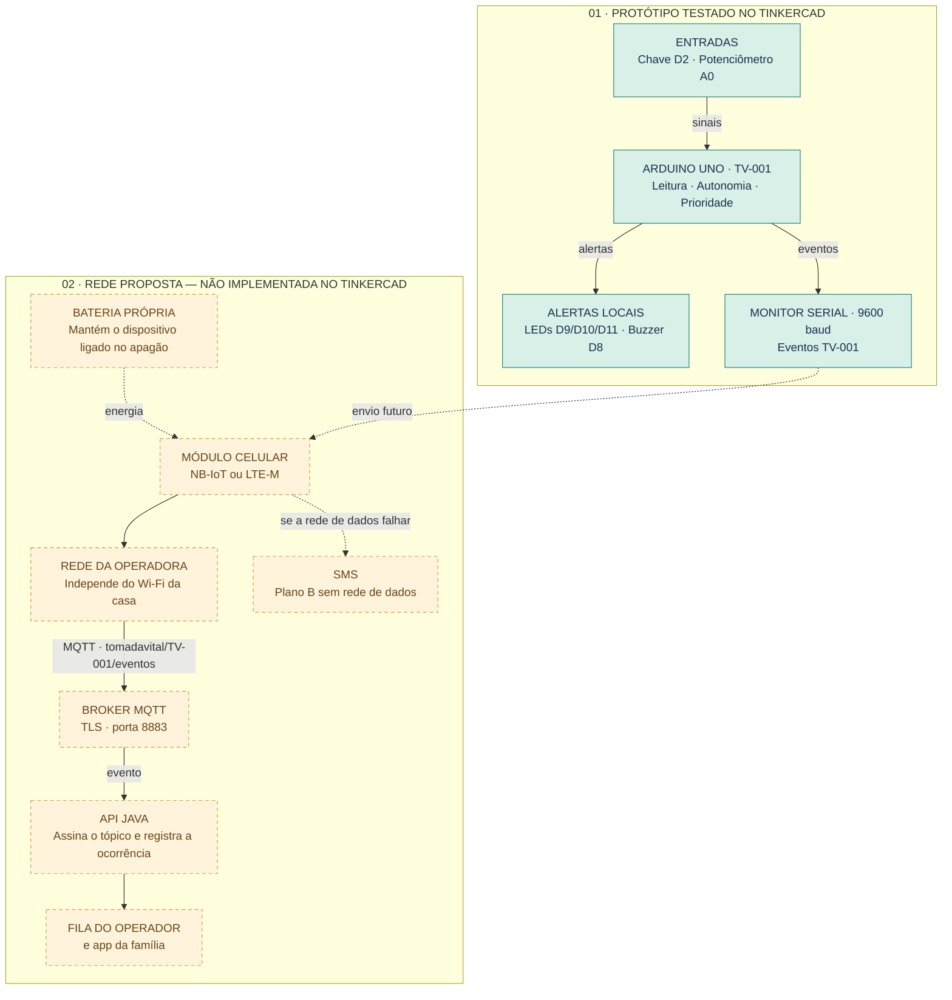

# Diagrama de arquitetura e comunicação — Tomada Vital

O diagrama separa o **protótipo testado no Tinkercad** da **rede proposta**, que não foi implementada no simulador.



## Identificação dos componentes

| Elemento | Implementado? | Papel |
|---|---|---|
| Chave deslizante D2 | Sim (simulado) | Presença ou queda de energia |
| Potenciômetro A0 | Sim (simulado) | Percentual de bateria do equipamento, lido no início da queda |
| Arduino UNO | Sim (simulado) | Leitura, cálculo e classificação |
| LEDs D9/D10/D11 e buzzer D8 | Sim (simulado) | Alertas locais |
| Monitor Serial (9600 baud) | Sim | Exibe eventos e resultados |
| Bateria própria do dispositivo | Não | Mantém o dispositivo ligado durante o apagão |
| Módulo celular NB-IoT ou LTE-M | Não | Envia os eventos sem depender do Wi-Fi da casa |
| Rede da operadora | Não | Conectividade externa |
| Broker MQTT com TLS (8883) | Não | Recebe os eventos no tópico `tomadavital/TV-001/eventos` |
| SMS | Não | Plano B quando a rede de dados falhar |
| API Java | Não neste protótipo | Assina o tópico, registra a ocorrência e monta a fila |
| Fila do operador e app da família | Não neste protótipo | Atendimento e acompanhamento |

## Mensagens previstas

Tópico MQTT proposto: `tomadavital/TV-001/eventos`

Evento como aparece no Monitor Serial do protótipo:

```text
TV-001;QUEDA;bateria=20;restante=96;prioridade=CRITICA
```

Dados que o dispositivo publicaria na versão proposta, no mesmo formato que a nossa API Java recebe em `POST /api/ocorrencias`:

```json
{ "codigoDispositivo": "TV-001", "bateriaPercentual": 20 }
```

## Limitações

O módulo celular, a bateria própria, o broker MQTT e o SMS fazem parte do desenho proposto, não do circuito executado no simulador. A bateria e o sensor de energia são representados por componentes de simulação, e os limites de autonomia são exemplos acadêmicos, não critérios médicos validados.
