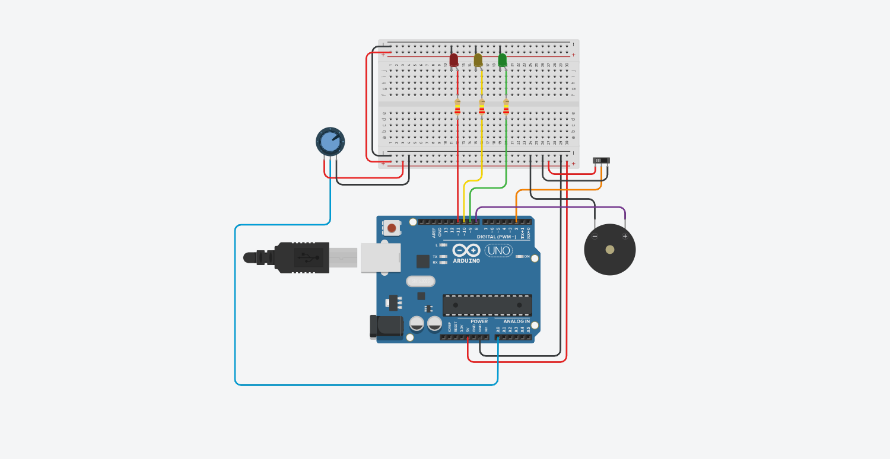
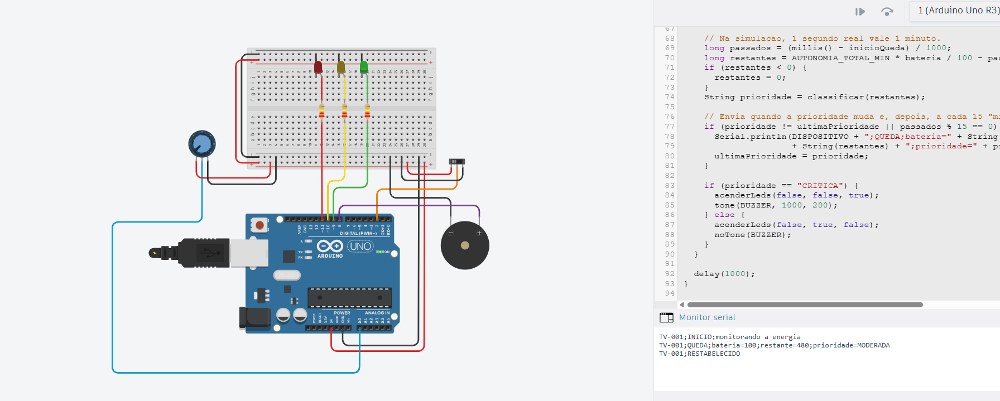
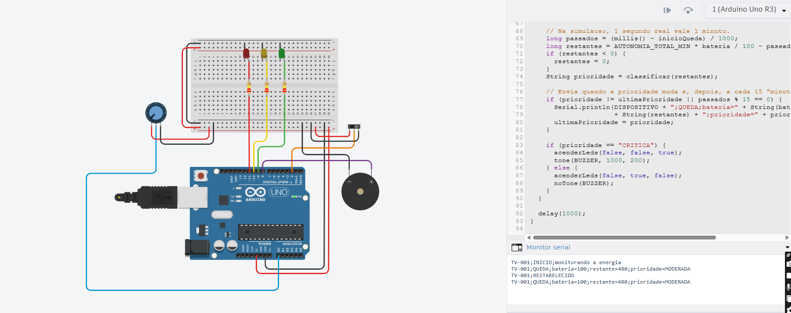
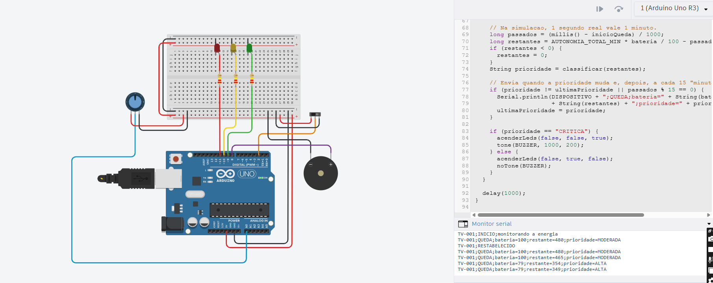
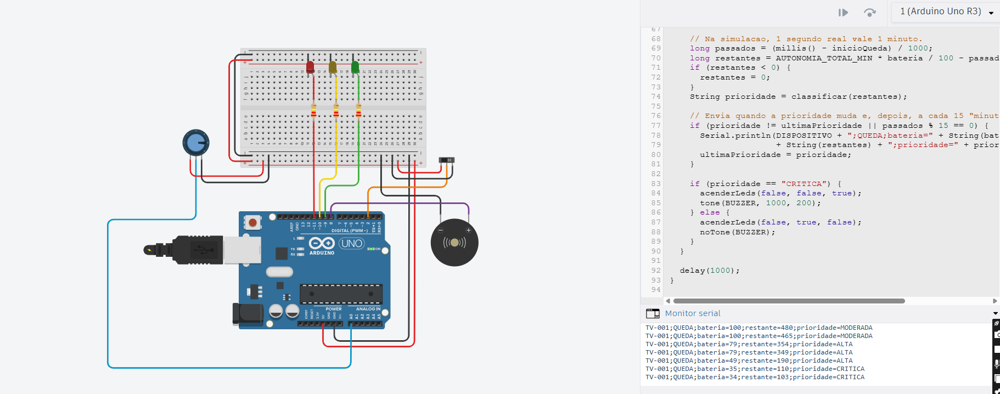
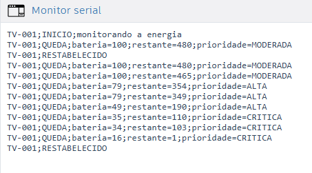

# Evidências do protótipo — Tomada Vital

Esta pasta reúne **seis capturas originais, em sequência**, feitas na simulação Arduino UNO no Tinkercad. Os comentários abaixo explicam os resultados registrados, sem modificar as imagens ou acrescentar dados fictícios.

> **Publicação em andamento:** o documento foi criado no GitHub; os arquivos PNG originais estão organizados no pacote de evidências para upload nesta pasta.

## 01 — Circuito geral

Montagem com Arduino UNO, chave deslizante (D2), potenciômetro (A0), LED verde (D9), amarelo (D10), vermelho (D11), resistores de 220 Ω e buzzer (D8).

## 02 — Inicialização e restabelecimento

O Monitor Serial registra `TV-001;INICIO;monitorando a energia`, um evento `QUEDA` com 100% de bateria e 480 minutos restantes, seguido de `TV-001;RESTABELECIDO`.

## 03 — Prioridade MODERADA

O Monitor Serial registra `TV-001;QUEDA;bateria=100;restante=480;prioridade=MODERADA`. Essa classificação corresponde a mais de 360 minutos restantes.

## 04 — Transição para prioridade ALTA

O histórico mostra a transição de MODERADA para ALTA, incluindo `bateria=79;restante=354;prioridade=ALTA` e `bateria=49;restante=190;prioridade=ALTA`.

## 05 — Prioridade CRITICA com buzzer

A imagem mostra a indicação visual de emissão de som no buzzer e mensagens como `bateria=35;restante=110;prioridade=CRITICA` e `bateria=34;restante=103;prioridade=CRITICA`.

## 06 — Histórico consolidado do Monitor Serial

O registro mostra as prioridades MODERADA, ALTA e CRITICA e o restabelecimento da energia. Inclui também `bateria=16;restante=1;prioridade=CRITICA`.

## Critérios de validação

| Cenário | Comportamento esperado |
|---|---|
| Energia disponível | LED verde |
| Queda; mais de 360 min restantes | MODERADA, LED amarelo |
| Queda; entre 121 e 360 min | ALTA, LED amarelo |
| Queda; até 120 min | CRITICA, LED vermelho e buzzer |
| Energia restabelecida | LED verde, buzzer desligado e mensagem `RESTABELECIDO` |

A simulação usa a equivalência de **1 segundo = 1 minuto** de autonomia.

**Limitações:** os sensores de energia e bateria são representados por uma chave e um potenciômetro. Não há ligação celular/MQTT implementada no Tinkercad. A autonomia e as prioridades são parâmetros didáticos, não critérios clínicos validados.
