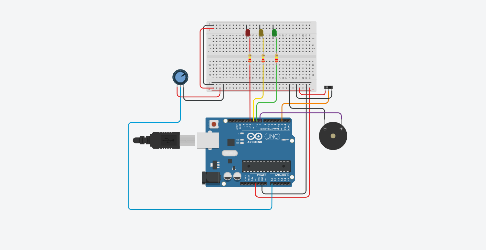
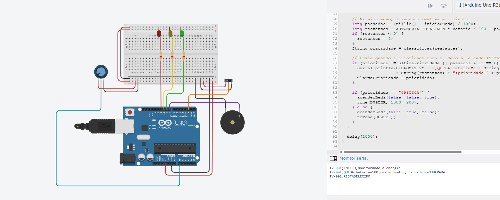
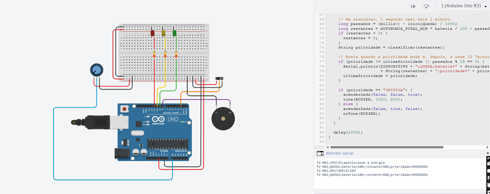
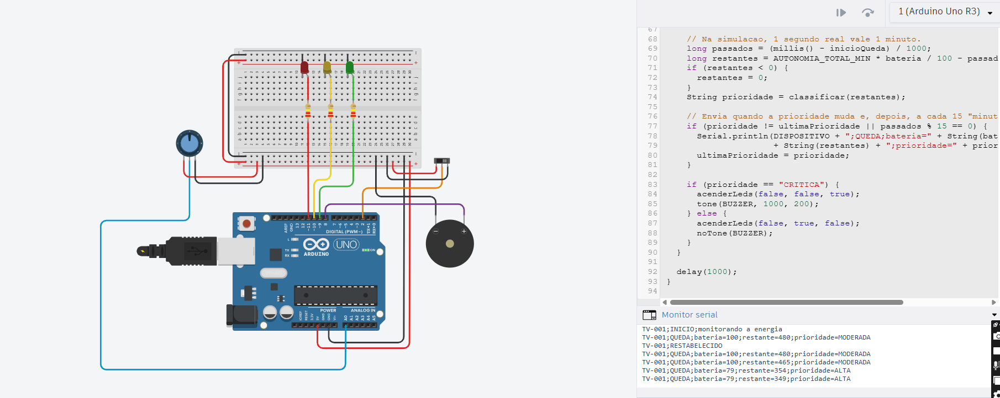
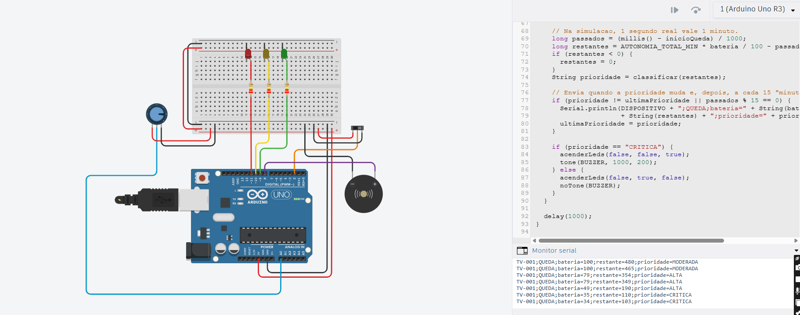
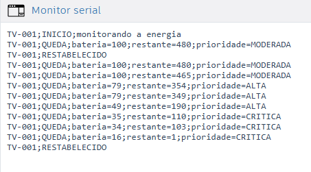

# Evidências do protótipo — Tomada Vital

Esta pasta reúne **seis capturas originais, em sequência**, feitas na simulação Arduino UNO no Tinkercad. As imagens não foram redesenhadas nem tiveram dados de resultados acrescentados. Os comentários explicam o que é possível observar; não representam testes com dispositivos médicos reais.

## 01 — Circuito geral

Montagem com Arduino UNO, chave deslizante (D2), potenciômetro (A0), LEDs verde (D9), amarelo (D10), vermelho (D11), resistores de 220 Ω e buzzer (D8). A captura apresenta o circuito como um todo; não comprova isoladamente um estado específico de alerta.

## 02 — Inicialização e restabelecimento

O Monitor Serial apresenta `TV-001;INICIO;monitorando a energia`, um evento `QUEDA` com bateria de 100% e autonomia de 480 minutos, e a mensagem `TV-001;RESTABELECIDO`. Isso comprova que o programa registrou a transição de volta à energia normal.

## 03 — Prioridade MODERADA

O Monitor Serial mostra `TV-001;QUEDA;bateria=100;restante=480;prioridade=MODERADA`. Pela regra definida no código, autonomia acima de 360 minutos corresponde a prioridade MODERADA.

## 04 — Transição para prioridade ALTA

O Monitor Serial registra a passagem de MODERADA para ALTA: bateria de 79%, restante de 354 e 349 minutos, posteriormente 49% e 190 minutos. A faixa ALTA é de 121 a 360 minutos restantes.

## 05 — Prioridade CRITICA e acionamento do buzzer

A captura mostra a indicação de som ativo no buzzer e eventos da Serial, incluindo `bateria=35;restante=110;prioridade=CRITICA` e `bateria=34;restante=103;prioridade=CRITICA`. Os limiares são exemplos acadêmicos; não representam critérios clínicos.

## 06 — Monitor Serial: histórico consolidado

Histórico textual com início, MODERADA, ALTA, CRITICA e `RESTABELECIDO`, incluindo o evento `bateria=16;restante=1;prioridade=CRITICA`. Demonstra a transição entre categorias ao longo dos testes.

## Critérios de teste e limites

- Energia normal: LED verde.
- Queda com autonomia superior a 360 min: prioridade MODERADA, LED amarelo.
- Queda com autonomia de 121–360 min: prioridade ALTA, LED amarelo.
- Queda com autonomia até 120 min: prioridade CRITICA, LED vermelho e buzzer.
- Retorno da energia: mensagem `RESTABELECIDO`, LED verde e buzzer desativado.
- Durante a simulação, 1 segundo representa 1 minuto de autonomia consumida.

**Limitações:** a chave representa a detecção de energia; o potenciômetro representa a bateria. Não existem sensores reais de rede/bateria nem conexão celular/MQTT implementada nesse protótipo. As capturas não substituem a execução demonstrativa no Tinkercad.
